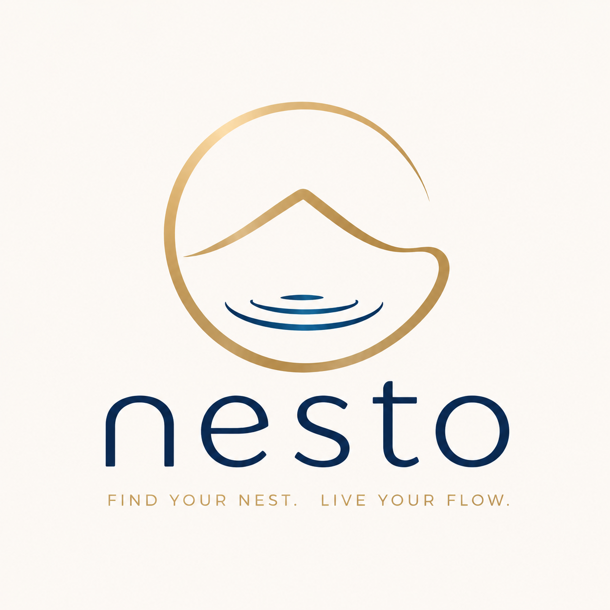
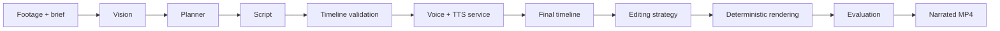

<p align="center"></p>

<h1 align="center">Nesto Housing Director</h1>
<p align="center"><strong>Eight specialized agents. One real estate video production workflow.</strong></p>
<p align="center">Walkthrough footage → visual understanding → narrative planning → narrated MP4</p>
<p align="center">
  <a href="https://yejiasong1-ferrari.github.io/nesto-housing-director-demo/demo.html">Watch the demo</a> ·
  <a href="#how-the-agents-work">Explore the architecture</a> ·
  <a href="docs/LOCAL_SETUP.md">Run locally</a>
</p>

## What it does

Nesto turns property walkthrough footage, a director brief, and property metadata into a narrated presentation video. It coordinates perception, creative planning, speech delivery, timeline alignment, editing strategy, rendering, and quality review through a shared **Project State**.

Built for real estate agents and small production teams, the workflow automates repetitive production steps while keeping the narration, scene decisions, and timing available for inspection in a **Next.js Studio** interface.

## Demo

[](https://yejiasong1-ferrari.github.io/nesto-housing-director-demo/demo.html)

**[Play the project demo](https://yejiasong1-ferrari.github.io/nesto-housing-director-demo/demo.html)** · [Download the MP4](docs/assets/nesto-demo.mp4)

The video introduces the workflow and shows an actual saved 55-second render from the local v3.1 project. Its narration track is reconstructed from the saved TTS files and recorded timing; background music is omitted in this public preview. Playback is prerecorded. See [media provenance](docs/MEDIA_NOTES.md).

## How the agents work

1. **Vision — build the factual scene inventory.** Segment rooms, select representative frames, identify visible features, and assemble a reusable Vision Knowledge Base.
2. **Planner — decide the property story.** Interpret the brief, select highlights, allocate attention, and arrange the narrative flow.
3. **Script — write grounded narration.** Generate scene-specific copy and validate coverage, style, and duration constraints.
4. **Voice — direct speech delivery.** Plan voice style, rhythm, pronunciation, and duration. A separate execution service performs TTS synthesis.
5. **Timeline — align speech with footage.** Check narration budgets before TTS, then reconcile scene timing with measured audio durations.
6. **Editing — plan the treatment.** Specify pacing, visual effects, transitions, subtitle styling, and audio treatment as structured decisions.
7. **Rendering — execute the plan.** Apply deterministic media operations with MoviePy/FFmpeg and export an MP4.
8. **Evaluation — review the result.** Check audiovisual alignment, subtitles, timeline consistency, cinematic choices, and technical quality; route a bounded correction pass.



Every stage reads and writes structured project state. LLM calls handle visual interpretation and language-heavy decisions; timing, constraints, media execution, and much of the routing are deterministic. Timeline rewriting and final review have explicit iteration bounds.

## Engineering focus

- **Grounded content:** narration is linked to the scene inventory and property brief.
- **Temporal consistency:** narration budgets, measured TTS durations, and render timing are coordinated across stages.
- **Inspectable outputs:** intermediate planning, scripts, voice specifications, timelines, and evaluation feedback remain structured artifacts.
- **Human review:** the Studio exposes preview, timeline, segment inspection, and script revision workflows.
- **Modular execution:** FastAPI services, a Next.js frontend, and a separate worker support the production pipeline.

## Source layout

```text
system/backend/agents/   Eight agent modules and their tests
system/backend/api/      FastAPI service endpoints
system/backend/workflow/ Orchestration and dependency handling
system/frontend/         Next.js Studio
system/worker/           Worker execution
system/supabase/         Persistence schema and migrations
configs/                 Workflow configuration
docs/                    Demo, media notes, and local setup
tools/                   Public demo build script
```

## Local setup

Python 3.10+, Node.js 18.17+, and FFmpeg are required. Model inference and TTS use your own provider credentials.

```bash
python -m venv .venv
source .venv/bin/activate
pip install -e ".[dev]"
cp .env.example .env
PYTHONPATH=system uvicorn backend.main:app --host 127.0.0.1 --port 8000
```

Open `http://127.0.0.1:8000/docs` for the API. For the Studio, invite setup, provider configuration, and worker startup, follow [LOCAL_SETUP.md](docs/LOCAL_SETUP.md).

## About this repository

## Validation

The public snapshot passes 54 existing timeline and evaluation tests:

```bash
python -m pytest system/backend/agents/timeline/tests system/backend/agents/evaluation/tests -q
```

The recorded demo was checked for 720p playback and chapter navigation. These checks cover the selected deterministic modules and the public presentation.

## Repository scope

This is a curated public source snapshot of the independent Nesto project, prepared for engineering review. The original development history, runtime workspaces, credentials, and uploaded customer/property data are outside this snapshot.

No open-source license has been selected for the project code. Third-party dependencies and demonstration footage retain their respective terms. The sample media is separate from the code; see [MEDIA_NOTES.md](docs/MEDIA_NOTES.md).

Created by **Jiasong Ye** · [LinkedIn](https://www.linkedin.com/in/jiasong-ye-a99211409/)
