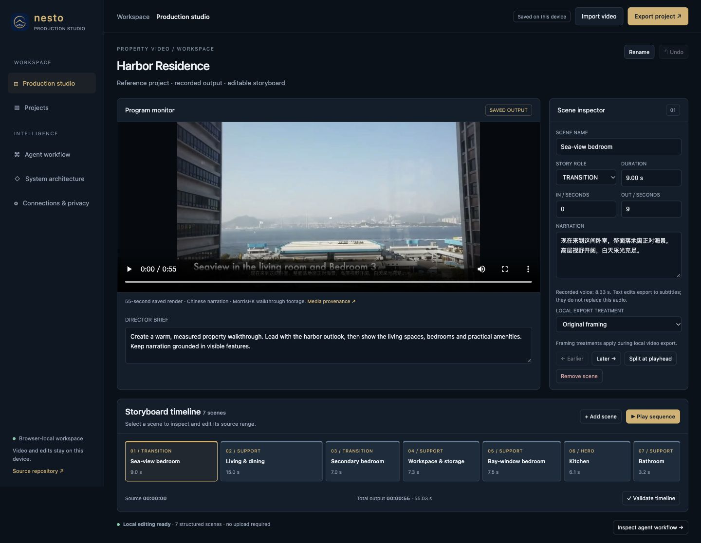
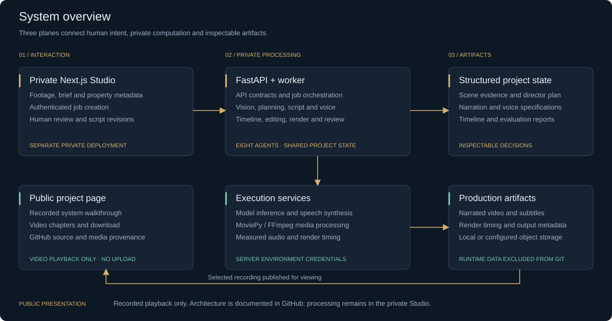
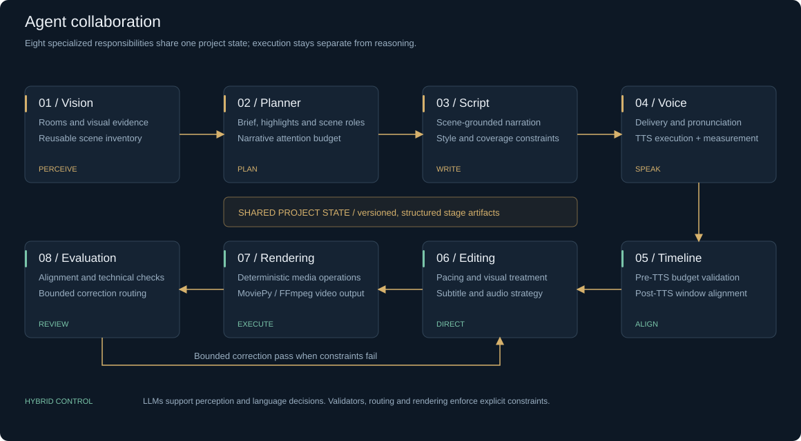
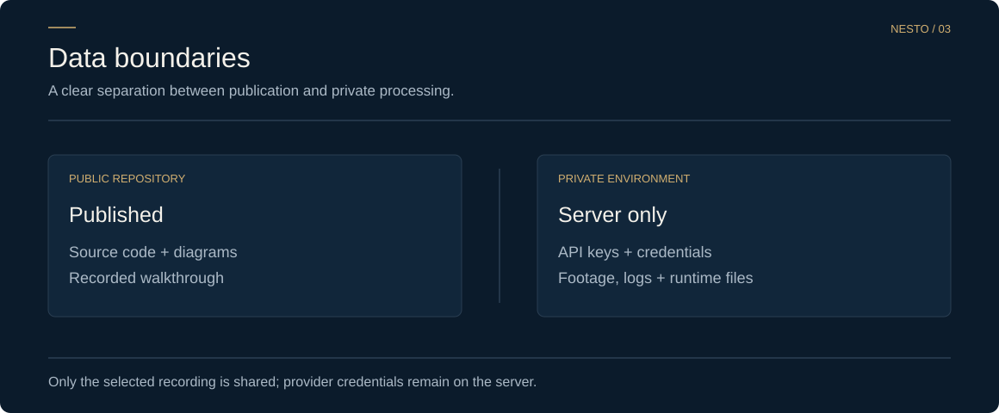
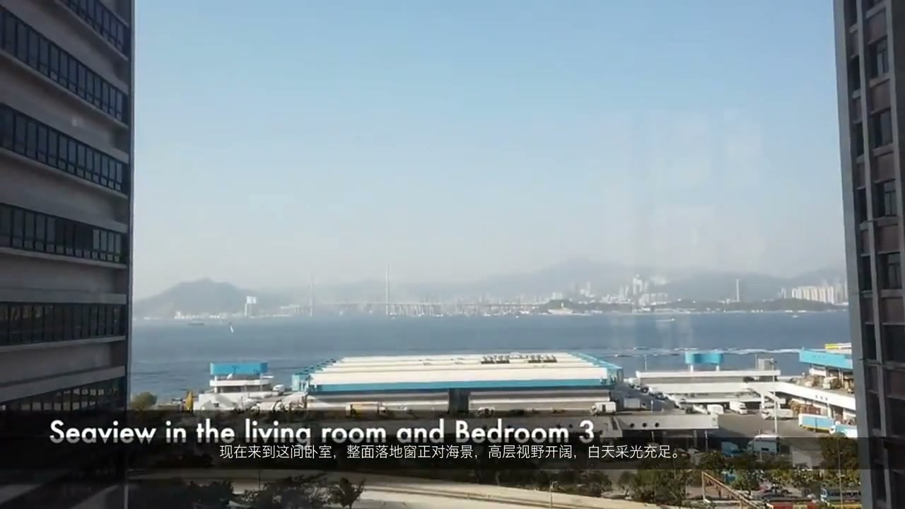

<p align="center"></p>
<h1 align="center">Nesto Housing Director</h1>
<p align="center"><strong>An inspectable production system for real estate video.</strong></p>
<p align="center">Visual evidence → narrative decisions → measured speech → a finished video</p>
<p align="center"><a href="https://yejiasong1-ferrari.github.io/nesto-housing-director-studio/">Open Production Studio</a> · <a href="docs/LOCAL_SETUP.md">Run the AI pipeline</a> · <a href="docs/SECURITY.md">Data boundaries</a></p>

Nesto coordinates **eight specialized agents** around a shared Project State to turn property walkthrough footage and a director brief into a narrated video. It brings visual analysis, storytelling, speech timing, editing and quality review into one workflow, with structured artifacts that a human can inspect and revise.

The system is designed for property agents and small production teams that need a consistent walkthrough narrative without manually rebuilding every script, speech window and edit decision.

## Production Studio



The [public workspace](https://yejiasong1-ferrari.github.io/nesto-housing-director-studio/) opens directly into an editable video project. It is a working browser application with:

- **Project management:** create from local footage, duplicate, archive/restore, and import/export portable project JSON.
- **Storyboard editing:** rename scenes, revise narration, trim source ranges, reorder or split scenes, and undo edits.
- **Timeline checks:** validate source boundaries and compare recorded speech duration with each scene window.
- **Preview and export:** play the edited sequence, export aligned SRT subtitles, and render a real video locally with original audio and optional captions.
- **Agent inspection:** explore each agent's responsibility, output contract and current project state.

Imported footage and edits stay in this browser's IndexedDB. Exported JSON contains the edit plan, so local footage must be relinked on another device. Video rendering uses Canvas/MediaRecorder; the available video format depends on the browser.

The included **Harbor Residence** reference project contains a recorded 55-second output and measured voice timings. Editing its text does not regenerate the existing speech. Model inference and TTS require the separate private backend described below; the public workspace does not simulate AI execution.

## System architecture



There are two interfaces within the system:

- **Public Production Studio:** browser-local editing, inspection, validation and export. No provider credentials are requested or shipped to the client.
- **Private Next.js Studio:** authenticated generation jobs, server-side agent orchestration, model/TTS calls, persistent storage and worker execution when configured by the operator.

The **FastAPI backend** owns the API contracts and shared project artifacts. A separate **worker** executes the generation workflow. **MoviePy/FFmpeg** apply deterministic media operations; model calls handle visual interpretation and language-heavy decisions.

## Eight-agent collaboration



1. **Vision** turns footage into a room/scene inventory and visual knowledge base.
2. **Planner** interprets the brief, prioritizes property highlights and arranges the narrative.
3. **Script** writes scene-grounded narration and checks style, coverage and duration budgets.
4. **Voice** plans delivery, rhythm and pronunciation; a separate TTS execution service synthesizes and measures speech.
5. **Timeline** checks budgets before TTS and reconciles final windows with measured speech afterward.
6. **Editing** specifies pacing, visual operations, subtitles and audio treatment as structured decisions.
7. **Rendering** executes the media plan and records output metadata and timing.
8. **Evaluation** reviews alignment, subtitles, timeline and technical quality, with bounded correction routing.

The shared state connects the scene evidence to the script, voice specification, edit plan and final render. Explicit timing constraints and correction limits make intermediate decisions inspectable rather than hiding the workflow behind one prompt.

## Data and credentials



This curated public snapshot excludes the original development history, provider credentials, runtime workspaces, logs, uploaded customer data and private deployment configuration. `.env.example` contains placeholders only. Provider keys belong in **server environment variables**, never in frontend bundles or public project files.

Run `python tools/privacy_check.py` before publishing. It scans the working tree and reachable Git blobs without printing credential values. Optional local-only comparison against a private environment file is documented in [SECURITY.md](docs/SECURITY.md). A scan supplements human review; it is not a guarantee that arbitrary media or text contains no private information.

## Recorded system walkthrough

[](https://yejiasong1-ferrari.github.io/nesto-housing-director-studio/?view=system)

Open **System architecture → System walkthrough** in the workspace, or [download the MP4](docs/assets/nesto-system-overview.mp4). The recording introduces the workflow and includes an actual saved local render. Speech is reconstructed from saved TTS files and recorded timing; background music is omitted. This recording does not rerun the AI pipeline. See [media provenance](docs/MEDIA_NOTES.md).

## Run locally

For the browser workspace, no package installation or API key is needed:

```bash
python -m http.server 8080 --directory docs
```

Open `http://localhost:8080`. To run private AI generation, use Python 3.10+, Node.js 18.17+, FFmpeg and your own compatible model/TTS providers:

```bash
python -m venv .venv
source .venv/bin/activate
pip install -e ".[dev]"
cp .env.example .env
PYTHONPATH=system uvicorn backend.main:app --host 127.0.0.1 --port 8000
```

Follow [LOCAL_SETUP.md](docs/LOCAL_SETUP.md) for the Next.js Studio, invite setup and worker. Review access controls, storage permissions and provider settings before processing private footage.

## Source map

```text
docs/                      Browser Production Studio and architecture diagrams
system/frontend/           Private Next.js Studio
system/backend/api/        FastAPI service endpoints
system/backend/agents/     Eight specialized agent modules
system/backend/workflow/   Orchestration and dependency handling
system/worker/             Generation worker
system/supabase/           Persistence schema and migrations
configs/                   Workflow configuration
tools/                     Publication scanner and diagram/media builders
```

## Validation

```bash
node --test docs/workbench-core.test.mjs
python tools/privacy_check.py
python -m pytest system/backend/agents/timeline/tests system/backend/agents/evaluation/tests -q
```

The browser core tests cover project sanitization, source ranges, subtitle timing, scene splitting and recorded-voice checks. The existing timeline/evaluation suites contain **54 passing tests**. These checks do not certify an arbitrary provider deployment or the complete model-generation pipeline.

No open-source license has been selected for the project code. Third-party dependencies and reference footage retain their respective terms. Media provenance is documented separately.
